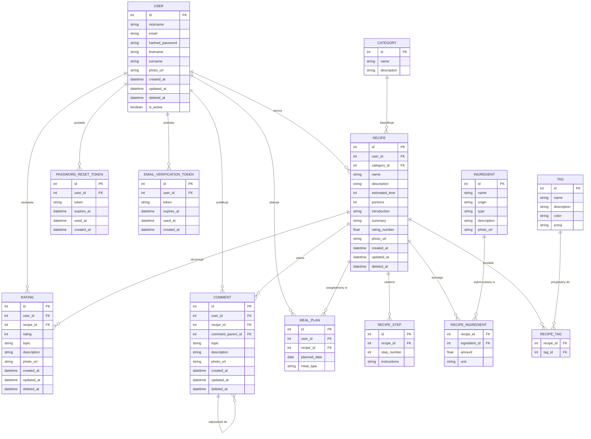

# whats-for-today
System zawierający przepisy i wspierający wymyślanie dań. Dlaczego taki system? a to dlatego, że każdy z nas zastanawia się co dzisiaj na obiad, co kupić albo co zrobić z tego co mam bo 10-ty za rogiem ahahha

# Schemat Bazy Danych (ERD)

